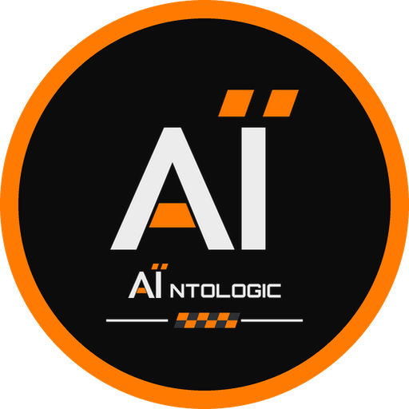

  

# AÏntologic

### Turn AI Into Logic

Practical tools for media, creativity, and sim racing—built with AI.

[Explore AÏntologic](https://www.aintologic.com/)

## What we do

AÏntologic turns AI-assisted ideas into useful software and creative workflows. We build, test, and refine tools that help people work with their media and make sim racing their own.

Our name brings AI and logic together: the aim is to turn possibilities into something practical.

## What we’re making

### Media Manglers · First public release in preparation

A Windows app for making more of narrated recordings: transcripts, screenshots, clips, and review packages you and your AI assistant can work with.

### [iRacing Paints](https://github.com/Aintologic/aintologic-iracing-paints) · Public on GitHub

Code-generated iRacing liveries: ready-made paints for 10 cars, or personalize your own name and logos with one command. Open source under AGPL-3.0.

### FreakFarm Hub · In development

Dashboards, overlays, and configurable displays for iRacing, built around SimHub to put useful driving information where you need it.

Public code and downloads appear here as projects are released. Visit [aintologic.com](https://www.aintologic.com/) for the project overview.
